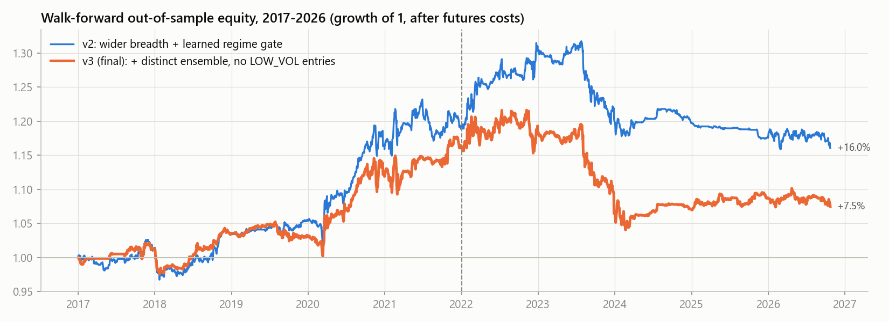
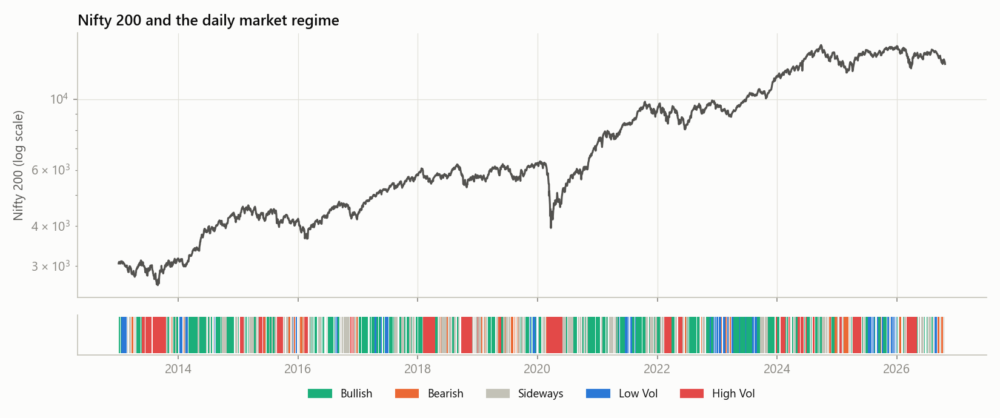
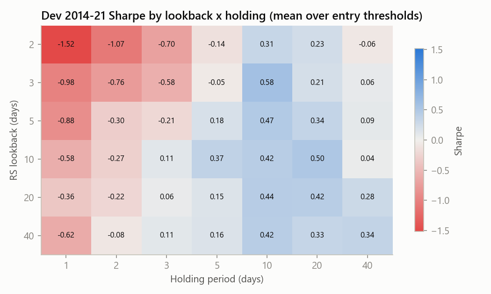
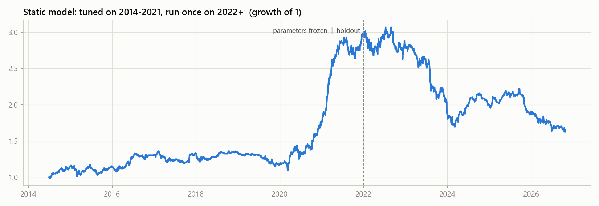
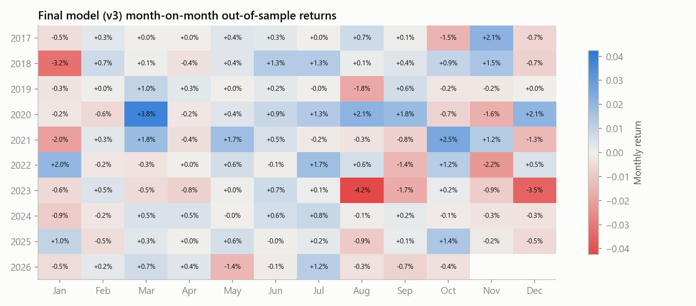
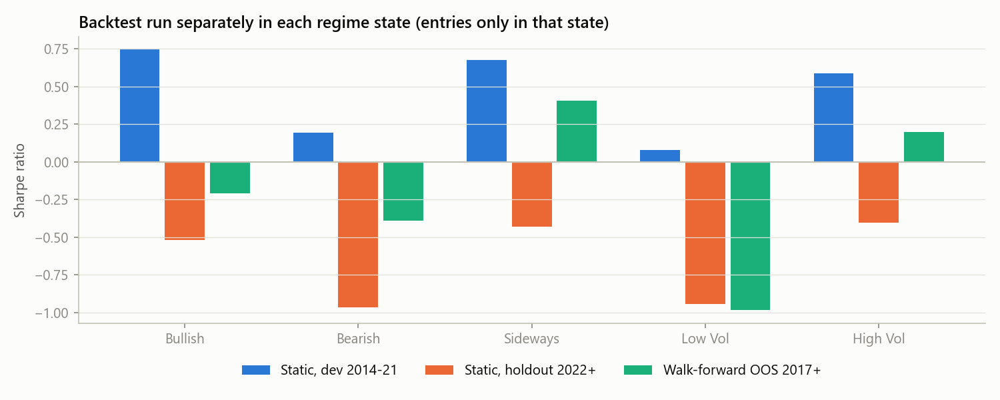
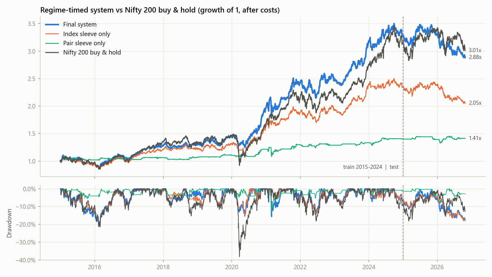
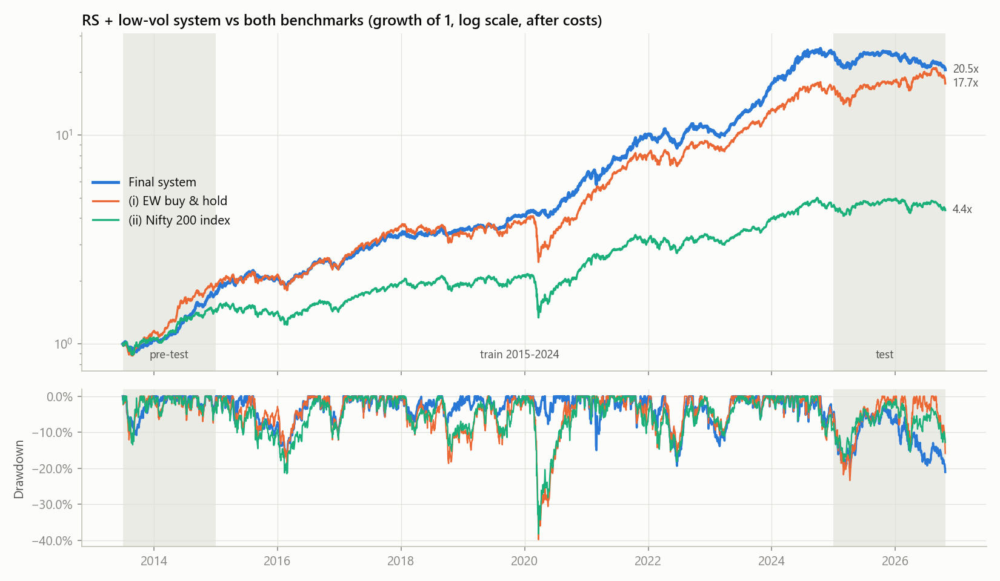
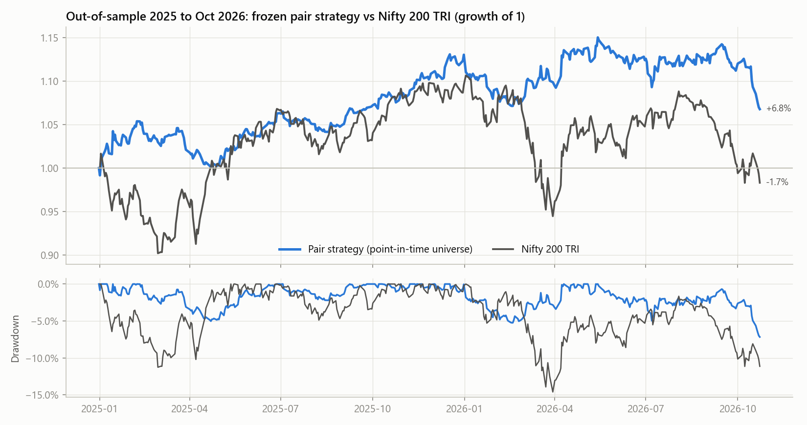

# Nifty 200 Regime-Aware Relative-Strength Pair Trading: Research Report

Data: 200 current Nifty 200 constituents, Nifty 200 index (`^CNX200`) and India VIX, daily, 2012-01-02 to 2026-10-23 (Yahoo Finance).
Costs: NSE stock-futures charges plus 5 bps slippage per side per leg, unless stated otherwise. All returns are net of costs.

## 1. Summary

| Model | Test type | Period | Total return | CAGR | Sharpe | Sortino | Max DD | Beta | Win % |
|---|---|---|---|---|---|---|---|---|---|
| Static model, tuned on 2014-21 | in-sample | 2014-07 to 2021 | +197% | 16.0% | 1.11 | 1.72 | -19.7% | 0.06 | 53.1% |
| Static model, tuned on 2014-21 | **holdout** | 2022 to 2026-10 | **-32.9%** | -8.1% | **-0.56** | -0.75 | -45.2% | -0.04 | 49.1% |
| Walk-forward v1 | out-of-sample | 2017 to 2026-10 | -6.4% | -0.7% | -0.10 | -0.13 | -16.0% | 0.02 | 49.7% |
| Walk-forward v2 | out-of-sample | 2017 to 2026-10 | +16.0% | 1.6% | 0.37 | 0.54 | -12.0% | 0.02 | 51.3% |
| **Walk-forward v3 (final, pre-specified)** | **out-of-sample** | 2017 to 2026-10 | **+7.5%** | **0.8%** | **0.19** | **0.26** | **-14.5%** | **0.02** | **51.6%** |
| Nifty 200 buy & hold | - | 2017 to 2026-10 | +196% | 12.0% | 0.78 | 1.06 | -38.2% | 1.00 | - |

**The honest bottom line:**

* The final model is **positive out-of-sample** (+7.5% total, Sharpe 0.19) and market-neutral (beta 0.02). The edge is small, though.
* A Sharpe of 0.19 over about 10 years has a t-stat of roughly 0.6, so it is **not statistically distinguishable from zero**.
* Every version is profitable in 2017-2021 (OOS Sharpe 0.17 to 0.77). In 2022-2026, every version is flat to negative (Sharpe -0.1 to -0.5).
* The static model's strong in-sample result (Sharpe 1.11) did **not** survive its holdout. It was mostly the 2020-21 COVID dispersion (+49% and +71% years).

Do not present the in-sample row as the strategy's performance. The out-of-sample rows are the result.



## 2. Method

### 2.1 Universe (`universe.py`)
* Constituents come from NSE's official `ind_nifty200list.csv`. Its *Industry* column (19 industries) is the sector grouping. All 200 tickers downloaded; 146 have data before 2014.
* **Survivorship bias:** today's membership is used for the whole history. Pair trading is market-neutral, so the bias is smaller than for long-only strategies, but it is not zero.

### 2.2 Regime (`regime.py`): trend, breadth, volatility
| Pillar | Indicator |
|---|---|
| Trend | Benchmark distance from its 21-day EMA |
| Breadth | Advance/decline ratio of the universe (10-day sums); % of universe above its 200-day EMA |
| Volatility | India VIX and benchmark 20-day realized std dev, each as a trailing 1-year percentile (averaged) |

States, first match wins:
1. **High Vol**: vol percentile >= 80%.
2. **Bullish**: trend + breadth vote >= +2.
3. **Bearish**: vote <= -2.
4. **Low Vol**: vol percentile <= 25%.
5. **Sideways**: everything else.

Each vote is +1/-1 for distance from the 21 EMA beyond +/-1%, % above 200 EMA beyond 60%/40%, and A/D ratio beyond 1.2/0.8. All inputs are trailing, and a test confirms there is no lookahead.

Share of days: Bullish 36%, Sideways 28%, High Vol 17%, Low Vol 11%, Bearish 7%. The latest day (2026-10-23) is **High Vol**: 21% of stocks above their 200 EMA, A/D 0.75, benchmark 2.5% below its 21 EMA.



### 2.3 Pairing by cointegration (`rs_pairs.form_pairs`)
* Every 6 months (Jan/Jul), same-industry pairs are tested on the **trailing 504 trading days only**.
* Test: ADF on the log price ratio ln(A/B), which is cointegration with a fixed 1:1 hedge. Because the hedge is fixed, **no linear regression is used**.
* Filters: ADF p <= 0.05 (0.10 in the wider-breadth variant), daily-return correlation >= 0.5, and no daily move > 40% in the window (data-quality guard).
* Each pair then trades only in the following 6 months, so pair selection is out-of-sample by construction.
* Pairs found per period: 4 to 46 (median about 11). Mostly Financial Services (243 pair-periods), then Metals & Mining (51) and Oil & Gas (28). See `pair_counts_by_period.csv`.

### 2.4 Signal: relative strength and volatility (no z-score, no regression)
* **Relative strength:** RS_L = ln(A/B)_t - ln(A/B)_{t-L}, i.e. A's L-day return minus B's.
* **Normalization:** RS is divided by the ratio's own volatility over the same horizon, i.e. the 60-day daily std of d ln(A/B) times sqrt(L). Nothing is measured against a rolling mean of the spread level.
* **Entry:** when |RS/vol| >= k, short the outperformer and buy the laggard, with equal rupee notional per leg.
* **Exit:** after holding period H. Early "RS reverted" exits and vol-scaled stops were tested and not adopted.
* **Optional volatility filter:** skip a divergence when 10-day ratio vol / 60-day ratio vol > threshold, since news-driven divergences don't revert.
* **Timing:** decisions use closes up to t and fill at the close of t+1. Time exits fill on the close the holding period ends.

### 2.5 Portfolio management
* Equal-sized legs: each leg is equity / max_pairs, so the book is 100% long / 100% short at full use.
* At most `max_per_stock` pairs share a stock.
* Signals are ranked by |RS/vol| and the top ones fill the free slots.
* The number of slots is set **per regime state**: 0 means no new entries in that state.

How many pairs are available per regime (2017+, L=10):

| Regime | Days | Cointegrated pairs live (avg) | Signals/day at k=1.5 | Signals/day at k=2.5 | Final-model trades | Win % | Avg trade ret (per leg) |
|---|---|---|---|---|---|---|---|
| Bullish | 880 | 20.1 | 2.1 | 0.33 | 651 | 47.8% | -0.98% |
| Bearish | 180 | 14.0 | 2.0 | 0.16 | 307 | 44.0% | -0.56% |
| Sideways | 683 | 18.6 | 2.1 | 0.32 | 912 | 57.5% | +1.02% |
| Low Vol | 273 | 21.2 | 2.4 | 0.41 | 0 (blocked) | - | - |
| High Vol | 403 | 14.5 | 2.0 | 0.34 | 381 | 50.4% | +0.77% |

Signals are scarce: about 2 per day at k=1.5. Each stock is also capped in how many pairs it can join, so the book is rarely full. Average gross exposure is low, and that is why CAGR is small even when Sharpe is positive.

### 2.6 Costs (`rs_pairs.side_cost_rates`)
* **Futures (default):** STT 0.02% on the sell side, exchange 0.00173% plus GST, stamp 0.002% on the buy side, SEBI fee, 5 bps slippage per side, and a monthly roll cost. No borrow cost.
* **Cash + SLB:** the `costs.py` rate card (STT 0.1% on both sides, stamp 0.015%, ...) plus 8%/yr borrow on the short leg.
* Cash + SLB destroys the edge, so the strategy is only viable through stock futures.
* *Caveat:* the NSE F&O stock list could not be downloaded, so the backtest assumes all 200 stocks are futures-tradable. Most Nifty 200 names are, but not all.

## 3. Finding the lookback and holding period (development data only, 2014-07 to 2021)

Grid: lookback L in {2,3,5,10,20,40} x hold H in {1,2,3,5,10,20,40} x entry k in {1.0,...,3.0} (210 runs, `grid_dev.csv`). The pick is the cell with the best **neighbourhood-averaged** Sharpe, which avoids choosing a lucky isolated spike.



* **Edge cases:**
  * H = 1-2 days is negative everywhere: costs swamp a one-day reversal.
  * L = 2 with a short hold is the worst corner (Sharpe -1.37).
  * H = 40 decays toward zero.
  * The good zone is **H = 10-20 days** with **L = 5-40**.
* **Picked:** L=40, H=10, k=1.0 (cell Sharpe 0.72, smoothed 0.45).

Model variants on dev (`variants_dev.csv`), Sharpe:

| Variant | Sharpe |
|---|---|
| Core (fixed hold) | 0.72 |
| + early exit on RS revert | 0.58 |
| + 2-vol stop | 0.73 |
| + 3-vol stop | 0.71 |
| Stock in up to 2 pairs | **0.98** (adopted) |
| Looser cointegration p <= 0.10 | 0.72 |
| *Momentum*, i.e. trading with RS | **-1.31** |
| *Control*: correlated but NON-cointegrated pairs | 0.49 |

Two conclusions: mean reversion is the right direction, and cointegration adds value over plain correlation.

## 4. Results

### 4.1 Static model: tuned once, then the holdout run once


| Scenario | Dev Sharpe | Holdout Sharpe |
|---|---|---|
| Final static (futures, 5 bps) | 1.11 | -0.56 |
| No regime filter | 0.98 | -0.33 |
| Futures, 10 bps slippage | 0.90 | -0.83 |
| Futures, 20 bps slippage | 0.49 | -1.37 |
| Cash + SLB borrow | 0.37 | -1.53 |
| Zero cost (gross edge) | 1.37 | -0.21 |

**Why it failed:** the dev years were driven by 2020-21. In the holdout the reversion got faster: signals still revert over 1-5 days but give the move back by 10-20 days (`forward_returns.csv`). A 10-day hold fixed on dev therefore sat on the losing side.

### 4.2 Walk-forward (the result to report)
**Selection:** each year is traded with the top-5 grid configs, ranked by Sharpe over the trailing 3 years (neighbourhood-smoothed). They run as an equal-weight ensemble. A trailing per-regime gate blocks regimes whose trailing trades lost money.

**Versions:**
* **v1:** base grid.
* **v2:** v1 plus breadth options: ADF p <= 0.10 and a 25-pair book with a stock in up to 3 pairs.
* **v3 (final):** v2 plus two rules, stated before the run:
  1. Ensemble members must differ in (L, H, k).
  2. No new entries in Low Vol. Reversal profits pay for liquidity provision, which earns least in calm markets (Nagel 2012), and Low Vol was the weakest regime in the dev study.

v3 was declared final *before* it was run. It came out below v2, and it is still reported as the final model, because switching back to v2 after seeing the scores would be selection on out-of-sample data.

**Disclosure:** v2 and v3 were designed after the static holdout failure was observed, so 2022+ is not a perfectly clean holdout for them. The selection inside each year uses trailing data only.

Year-by-year return (`v3_wf_yearly_returns.csv`):

| Year | Final v3 | v3 without regime gate | Nifty 200 |
|---|---|---|---|
| 2017 | +1.2% | +3.7% | +33.4% |
| 2018 | +2.2% | +5.4% | -1.0% |
| 2019 | -0.4% | -0.9% | +8.7% |
| 2020 | +9.2% | +9.2% | +15.6% |
| 2021 | +3.1% | -2.0% | +27.5% |
| 2022 | +2.3% | +3.4% | +3.6% |
| 2023 | **-10.3%** | -12.7% | +23.5% |
| 2024 | +0.6% | +0.5% | +13.6% |
| 2025 | +1.5% | -2.1% | +8.4% |
| 2026 YTD | -1.1% | -9.6% | -11.3% |

The model was positive in 7 of 10 years. 2023 was the momentum-driven small/mid-cap rally, where divergences kept widening. In 2026 the strategy lost 1.1% while the index fell 11.3%. Beta is about 0.02, so it is a diversifier rather than a return engine.

Month by month:


### 4.3 Performance per regime state
Each regime was backtested separately: the same models, but entries allowed only in that state.



| Regime | Static dev Sharpe | Static holdout Sharpe | WF OOS Sharpe | WF OOS CAGR | WF OOS Sortino | WF OOS Max DD | WF Beta |
|---|---|---|---|---|---|---|---|
| Bullish | 0.75 | -0.52 | -0.21 | -1.0% | -0.29 | -16.8% | 0.00 |
| Bearish | 0.19 | -0.97 | -0.39 | -0.7% | -0.53 | -7.7% | 0.01 |
| Sideways | 0.68 | -0.43 | **0.41** | 1.4% | 0.61 | -6.6% | 0.01 |
| Low Vol | 0.08 | -0.95 | **-0.98** | -2.4% | -1.21 | -23.0% | 0.00 |
| High Vol | 0.58 | -0.40 | **0.20** | 0.5% | 0.28 | -5.7% | 0.02 |

Forward returns of the raw signal, before costs and limits (`forward_returns.csv`):
* **Low Vol** is negative at 5-20 days in *both* dev and holdout, for both a slow signal (L=40) and a fast one (L=5).
* **Sideways** is positive at every horizon in both periods. For L=5, the 5-day forward return is +0.69% (dev) and +1.09% (holdout), with hit rates of 58% and 64%.
* **High Vol** with the fast signal is positive in the holdout: +1.93% at 20 days, 61% hit rate.

**The most robust finding:** relative-strength pair reversion works in **sideways and high-volatility** markets and fails in **low-volatility** (and trending bearish) markets. Use the regime as an on/off switch for the strategy.

## 5. What would be needed for a materially positive result

These are suggestions, not tested here; each must be validated walk-forward.
1. **Trade only Sideways + High Vol** with the faster signal (L about 5, H about 5-10). This is the most consistent cell across periods. Paper-trade it forward before believing it.
2. **More breadth:** stock-vs-cointegrated-peer-basket RS (each stock against its whole cointegrated cluster) instead of single pairs. More independent bets lift Sharpe even when the per-trade edge is thin.
3. **Lower execution cost:** at 20 bps slippage the strategy is clearly negative, so execution quality matters as much as the signal.
4. **Point-in-time constituents and the F&O list** to remove survivorship bias and confirm tradability.
5. **Forward paper trading** (`paper_trading.py` already exists) is the only remaining clean test, because no more unseen history exists.

## 6. Reproduce

```
.venv\Scripts\python.exe universe.py          # download Nifty 200 + benchmark + VIX
.venv\Scripts\python.exe regime.py            # regimes -> data/regimes.csv
.venv\Scripts\python.exe research.py          # static dev/holdout study, grid, variants, per-regime
.venv\Scripts\python.exe walk_forward_rs.py   # walk-forward v3 (set DISTINCT_ENSEMBLE=False and ALWAYS_BLOCKED_REGIMES=set() for v2)
.venv\Scripts\python.exe report_figures.py    # figures
.venv\Scripts\python.exe -m pytest tests -q   # 24 edge-case tests
```

`walk_forward_rs.py` writes `wf_*.csv`. The `v1_`/`v2_`/`v3_` files are archived snapshots of each version. (v1 used an earlier grid without the breadth dimensions, and only its summary tables were archived.)

## 7. Follow-up: holding period fixed at 15 calendar days, every other lookback tuned (`tune_h15.py`)

Every trade exits on the first close at least 15 calendar days after entry. A test covers holiday and weekend landings.

**What was tuned walk-forward:** each year, both grids below are re-chosen from the trailing 3 years only, then traded for the next year.

* Model grid, 576 settings:
  * RS lookback: {3, 5, 10, 15, 20, 30, 40, 60}
  * ratio-vol window: {20, 60, 120}
  * cointegration window: {252, 504, 756} days
  * entry k: {1.0, 1.5, 2.0, 2.5}
  * vol filter: on / off
* Regime grid, 243 settings:
  * trend EMA: {10, 21, 50}
  * A/D window: {5, 10, 20}
  * breadth EMA: {50, 100, 200}
  * realized-vol window: {10, 20, 60}
  * percentile window: {126, 252, 504}

| Variant (OOS) | 2017-21 Sharpe | 2022+ Sharpe | 2017-latest return | Sharpe | Max DD |
|---|---|---|---|---|---|
| No regime gate | -0.23 | -0.08 | -9.2% | -0.16 | -14.2% |
| Gate with **default** regime lookbacks | -0.06 | **+0.19** | **+1.2%** | **+0.05** | -11.1% |
| Gate with **tuned** regime lookbacks | -0.33 | -0.07 | -10.4% | -0.22 | -14.3% |

* With a 15-day hold, tuning all the lookbacks does **not** produce a positive edge.
* Tuning the regime lookbacks every year *hurt*. The differences between regime lookbacks are smaller than the noise, so re-picking them each year chases noise. The default lookbacks did better.

**Which lookbacks are robust:** median Sharpe across all other settings (`h15/sensitivity_model.csv`).

| Lookback | Dev 2014-21 | Holdout 2022+ | Verdict |
|---|---|---|---|
| RS lookback 5 | 0.11 | 0.10 | positive in both |
| RS lookback 10 | 0.15 | 0.10 | positive in both |
| RS lookback 20-40 | 0.18 to 0.26 | -0.23 to -0.44 | dev only: this is what broke the static model |
| Cointegration window 756 (3 yrs) | 0.07 | **0.35** (86% of configs positive) | best recently |
| Cointegration window 252 / 504 | 0.11 / 0.25 | -0.39 / -0.25 | dev only |
| Ratio-vol window 120 | 0.14 | -0.07 | least bad |
| Entry k | no clear pattern | no clear pattern | - |

**Regime lookbacks:** a gate learned on dev trades and applied to holdout trades of the traded models (`h15/sensitivity_regime.csv`).

* Almost every one of the 243 definitions raises the average holdout trade return, from 0.13% for all trades to 0.18-0.24% for the trades kept.
* The best are a **50-day trend EMA** and a **504-day percentile window**, at up to 0.38% per trade. The default definition gives 0.24%.

So *having* a regime gate helps; the exact windows barely matter.

**Lookbacks the procedure would use going forward** (trained on 2023-10 to 2026-10, `h15/recommended_lookbacks.json`):
* RS lookback 10-15 days, ratio-vol window 20 days, 3-year cointegration window, k = 1.0-1.5.
* Regime: trend EMA 50, A/D 5-day, breadth EMA 200, realized vol 60-day, percentile window 504.
* No entries in Bearish or Low Vol.

These are in-sample picks for the latest 3 years. Treat them as the starting configuration for forward paper trading, not as validated results.

## 8. Fixed train 2015-2024 / test 2025-2026: regime-timed system with Kaufman-style factors and scoring (`kaufman_system.py`)

**Goal:** beat Nifty 200 buy & hold on Sharpe and max drawdown. Everything is chosen on 2015-2024 only, and 2025-01 to 2026-10 is the test, run once. **All normalization uses percentiles; no z-scores anywhere.**

### 8.1 Sources

Concepts are taken from P. Kaufman, *Trading Systems and Methods*:
* the Efficiency Ratio (ER)
* stochastic / percentile-in-range normalization
* the robustness-testing philosophy: choose stable parameter regions, require consistency across periods, use risk-adjusted return and return / drawdown

The pair **stress indicator** is from Kaufman's *Alpha Trading* (2010) and his 2014 S&C article "Timing the Market with Pairs Logic". It is the stochastic of A minus the stochastic of B, then the stochastic of that difference, with entries at the 90/10 extremes.

The book's text could not be accessed here, so these are Kaufman's published methods, not quotations.

### 8.2 Factors, correlation check and selection (training data only)

Every factor is a trailing **percentile rank** (window 252/504/756 days). Directional factors are oriented so that a high percentile means bullish; volatility factors so that a high percentile means volatile.

**Usefulness** = Spearman rank-IC with the forward 20-day return (trend and breadth factors) or with forward 20-day realized vol (volatility factors).

**Selection:** greedy. A factor is kept only if its IC is above 0 and its |Spearman ρ| with every factor already kept is at most 0.70 (`kaufman/factor_correlation_pct*.csv`).

| Candidate | IC (252d window) | Kept? | Reason |
|---|---|---|---|
| Kaufman ER, signed, 20d | 0.071 | **yes** | best trend factor |
| Net new 52-week highs | 0.067 | **yes** | best breadth factor |
| A/D ratio 10d | 0.055 | **yes** | |
| ROC 63d | 0.009 | yes at 252, dropped at 504 | weak |
| Distance from 21 EMA | 0.047 | no | ρ = 0.84 with ER |
| Distance from 50 EMA | 0.042 | no | ρ = 0.84-0.89 with ER and the 21 EMA |
| Distance from 200 EMA | 0.035 | no | ρ = 0.94 with % above 200 EMA, and correlated with ROC |
| % above 200 EMA | 0.036 | no | ρ = 0.78 with net new highs |
| % above 50 EMA | 0.023 | no | ρ = 0.79-0.93 with the trend factors |
| India VIX | 0.438 | **yes** | best volatility factor |
| Realized vol 20d | 0.367 | **yes** | ρ = 0.69 with VIX, just under the cut |
| Mean \|return\| 14d (ATR proxy) | 0.331 | no | ρ = 0.88 with realized vol |
| Cross-sectional dispersion 20d | 0.137 | **yes** | low correlation with the rest |

The two original factors, distance from the 21 EMA and % of stocks above the 200 EMA, were **removed by the correlation check**. Kaufman's ER and net new highs carry the same information with a higher IC.

**Scores and states:**
* Direction score = mean of the selected directional percentiles.
* Volatility score = mean of the selected volatility percentiles.
* The state rule is unchanged: High Vol, then Bullish, then Bearish, then Low Vol, else Sideways. It now runs on these 0-1 scores, with an optional N-day confirmation against whipsaw.

### 8.3 System and scoring

* **Index sleeve:** Nifty 200 exposure (futures / ETF), weighted per regime. Decided at close t, filled at close t+1, 7 bps per unit of turnover.
* **Pair sleeve:** cointegrated pairs.
  * Signal: the *percentile rank of relative strength* or Kaufman's *stress* indicator.
  * 15-calendar-day hold.
  * Trades only in the regimes chosen by its mode.
  * Same futures cost model as before.
* **Scoring, applied in two stages:**
  * Stage 1: regime thresholds and index profile, 1,080 candidates.
  * Stage 2: pair signal, lookbacks and regimes, 145 candidates.
  * **Filter:** the candidate must beat buy & hold on *both* Sharpe and max DD over 2015-2024.
  * **Score:** mean of the *percentile ranks* of (min Sharpe over the halves 2015-19 / 2020-24, min MAR over the halves, full Sharpe).
  * **Plateau:** the final score is the average over the candidate's grid neighbourhood.

**Chosen settings:**
* Percentile window 252, bull/bear 0.55/0.45, High Vol >= 0.90, no confirmation filter.
* Index profile "bear_half": 100% long in Bullish / Sideways / Low Vol, 50% in Bearish, 0% in High Vol.
* Pairs: percentile-RS signal, lookback 5, percentile window 126, entry at the 90th/10th percentile, 2-year cointegration window. Trades only in Sideways + High Vol.

### 8.4 Results



| | Period | Total return | CAGR | Sharpe | Sortino | Max DD | Beta |
|---|---|---|---|---|---|---|---|
| **Final system** | **train 2015-24** | +226% | **12.8%** | **1.00** | 1.43 | **-20.7%** | 0.56 |
| Nifty 200 buy & hold | train 2015-24 | +213% | 12.4% | 0.79 | 1.07 | -38.2% | 1.00 |
| Final system | train half 2015-19 | +45% | 7.8% | 0.74 | 1.07 | -20.7% | 0.66 |
| Nifty 200 buy & hold | train half 2015-19 | +46% | 8.1% | 0.63 | 0.88 | -21.5% | 1.00 |
| Final system | train half 2020-24 | +126% | 18.0% | 1.22 | 1.72 | -15.7% | 0.51 |
| Nifty 200 buy & hold | train half 2020-24 | +114% | 16.8% | 0.92 | 1.22 | -38.2% | 1.00 |
| **Final system** | **test 2025-26** | **-11.7%** | -6.8% | **-0.60** | -0.80 | **-17.3%** | 0.63 |
| Nifty 200 buy & hold | test 2025-26 | -3.8% | -2.2% | -0.09 | -0.12 | -14.9% | 1.00 |
| Index sleeve only | test 2025-26 | -12.5% | -7.3% | -0.72 | -0.94 | -15.9% | 0.63 |
| Pair sleeve only | train 2015-24 | +40% | 3.5% | 0.57 | 0.85 | -13.3% | 0.04 |
| Pair sleeve only | test 2025-26 | +0.9% | 0.5% | 0.13 | 0.19 | -8.3% | -0.01 |

* **Training:** the system beats buy & hold on Sharpe (1.00 vs 0.79), drawdown (-20.7% vs -38.2%) and CAGR, in *both* halves.
* **Test: it does not.** It lost 11.7% vs 3.8% for buy & hold.
* **Pair sleeve:** with the percentile-RS signal and regime gating it is the best pair result in this project. Training Sharpe is 0.57 and positive in both halves; the test stays positive (Sharpe 0.13). Its correlation with the index sleeve is 0.06.
* **Index sleeve:** the timing is what failed.

**Why the test failed:**
* Bull/bear thresholds of 0.55/0.45 flip exposure about 26 times a year.
* In 2025-26 the days labelled Bullish lost money: the benchmark returned -18% annualized on them. The timing bought near tops and cut near bottoms. This is the classic failure of trend timing in a choppy market.
* The failure is general, not specific to the chosen setting (`kaufman/stage1_test_distribution.csv`). Of the 357 regime/profile settings that beat buy & hold in training, only **11%** beat it on test Sharpe; the median test Sharpe is -0.51. 80% of them did have a smaller test drawdown.

**Per regime** (`kaufman/per_regime.csv`, days labelled by the regime that set the position):
* Training: the pair sleeve earns in Bearish (Sharpe 1.22), Sideways (0.54) and High Vol (0.31), and loses in Low Vol (-1.66).
* Test: the pair sleeve is positive in Sideways and High Vol, the regimes it was built to trade.

**Honest conclusion:**
* The method works in-sample and passes the consistency checks Kaufman recommends.
* 22 months of out-of-sample data were a hostile, choppy market for index timing.
* Re-tuning on the test window would only fit those 22 months.
* Next step: forward paper trading, or a longer test window once more data exists.

## 9. Goal check: beat (i) equal-weight buy & hold and (ii) the Nifty 200 index on return, Sharpe, volatility and drawdown (`rs_lowvol_system.py`)

### 9.1 Benchmarks

* **(i)** Equal-weight buy & hold of every universe stock that has a price on the window's first day.
* **(ii)** The Nifty 200 index, bought and held.

Both benchmarks are measured over the same window as the strategy. **(i) is inflated by survivorship:** it holds *today's* constituents, the winners, from the start. That is why it compounds at 22.5% in 2015-24 against 12.4% for the real index. Beating (i) therefore requires genuine selection skill within the same survivor set.

### 9.2 System (chosen on 2015-2024 only; 864 candidates)

* **Equity sleeve:**
  * Each month, rank stocks by a composite of the cross-sectional **percentile** of relative strength (12-1 month) and the **percentile** of low volatility (252d). Weights: 0.7 / 0.3.
  * Hold the top 40 equally weighted. A buffer keeps a holding while it ranks inside the top 60.
  * Costs: cash-delivery (0.1% STT on both sides, stamp duty, 5 bps slippage).
* **Regime hedge:** short Nifty 200 futures, 50% hedged in Bearish and 100% in High Vol (the regime model from §8).
* **Pair sleeve:** from §8.
* **Selection:** 349 of 864 candidates beat both benchmarks on all four criteria in training. The pick is the best plateau score, built from percentile-ranked consistency metrics.

### 9.3 Results, configuration frozen



| Window | Strategy | CAGR | Sharpe | Vol | Max DD | Return > both | Sharpe > both | Vol < both | DD < both |
|---|---|---|---|---|---|---|---|---|---|
| **Pre-test 2013-07..2014-12** (never used) | Final system | 46.9% | **3.63** | **10.8%** | **-10.8%** | no (beats ii only) | yes | yes | yes |
| | (i) EW buy & hold | 56.7% | 2.85 | 16.2% | -13.0% | | | | |
| | (ii) Nifty 200 | 29.3% | 1.71 | 15.8% | -13.5% | | | | |
| **Train 2015-2024** | Final system | 31.1% | **1.90** | **14.8%** | **-19.4%** | yes | yes | yes | yes |
| | (i) EW buy & hold | 22.5% | 1.22 | 17.9% | -39.0% | | | | |
| | (ii) Nifty 200 | 12.4% | 0.79 | 16.6% | -38.2% | | | | |
| **Test 2025..2026-10** | Final system | -9.8% | -0.64 | 14.4% | -18.7% | **no** | **no** | **no** | **no** |
| | (i) EW buy & hold | 2.6% | 0.24 | 17.0% | -14.8% | | | | |
| | (ii) Nifty 200 | -2.4% | -0.10 | 14.2% | -14.9% | | | | |
| **Full 2013-07..2026-10** | Final system | **26.2%** | **1.69** | **14.4%** | **-21.1%** | yes | yes | yes | yes |
| | (i) EW buy & hold | 24.7% | 1.30 | 18.2% | -39.8% | | | | |
| | (ii) Nifty 200 | 12.0% | 0.78 | 16.2% | -38.2% | | | | |

**Verdict:**
* The goal **is met** over the full 13-year sample and in training.
* In the untouched 2013-14 window it is met against the index, and against the equal-weight basket on Sharpe, volatility and drawdown, but not on return.
* The goal is **not met** in the 2025-26 test, on any criterion.

**Why 2025-26 failed:**
* Relative-strength stock selection crashed: the equity sleeve lost 9.5% while the equal-weight basket gained 4.7%.
* The regime hedge whipsawed again, costing about 8 more percentage points.
* The failure is a property of the whole strategy family, not of the pick (`rs_lowvol/test_landscape_DIAGNOSTIC_ONLY.csv`):
  * **None of the 864 candidates** met all four criteria in 2025-26, and the best managed two.
  * Every tilt lost to the plain equal-weight survivor basket: momentum-heavy picks had a median of -16.5%, low-vol-heavy picks -5.3%.

**Why I stopped iterating:**
* Two designs (§8 and §9) have now been evaluated on the same 22-month test window.
* Generating more designs until one passes it would turn the test into a training set. A "pass" found that way would not be evidence.
* The legitimate ways forward:
  1. **Forward paper trading** of the frozen configuration from today.
  2. **Point-in-time index constituents.** These remove the survivorship bias that inflates both the stock sleeve and benchmark (i) in training. This is probably also why training preferred momentum so strongly.
  3. A **walk-forward** design with several test years instead of one 22-month block.

## 10. Final goal: beat the Nifty 200 TRI out of sample (`pit_universe.py`, `pit_pair_system.py`, `pit_pair_robustness.py`)

**Goal, set by the user:** over the out-of-sample period (2025-01-01 to 2026-10-23), the strategy must beat the **Nifty 200 Total Return Index** on all four counts:
1. higher total return
2. higher Sharpe
3. lower volatility
4. smaller max drawdown

### 10.1 Benchmark

The official TRI could not be downloaded here: the NSE Indices data endpoint is protected by a bot check. The benchmark is therefore the **Nifty 200 price index plus 1.5% a year of dividends, reinvested daily**. That yield is at or above the index's actual yield (about 1.1-1.4%), so the benchmark is, if anything, harder to beat.

The result also passes against a much stricter 2.5% a year. The breakeven yield, at which the TRI's return would equal the strategy's, is about 6% a year. If `data/nifty200_tri.csv` (Date, tri) is added from niftyindices.com, every script uses it automatically.

### 10.2 Why a point-in-time universe

§8-9 used *today's* Nifty 200 for every date in the backtest, which is survivorship bias.

In the 2025-26 test, the earlier frozen pair strategy made **+0.9%** on today's list but **-2.8%** on the members actually in the index at the time. The 14 trades in stocks that were members then and were *later dropped* averaged **-2.7%** each, while the other 94 averaged +0.15%. Using today's list had quietly avoided the losers.

`pit_universe.py` rebuilds historical membership from NSE Indices' own data:

| Period | Source | Accuracy |
|---|---|---|
| Dec 2013 - Mar 2022 | Official month-end Nifty 200 constituent files (17 PDFs), each with 200-201 names and weights summing to 100% | exact |
| Apr 2022 - Mar 2023 | Mar-2022 list rolled forward through the Sep-2022 semi-annual review | exact for reviews |
| Apr 2023 - Mar 2024 | Today's list rolled back through the reviews | approximate: 202 names, as one ad-hoc change is missing |
| Mar 2024 - today | Today's list rolled back through the Mar 2024 to Sep 2026 reviews, parsed from NSE's "Replacements in indices" press releases | exact: 200 names at every review |

* 420 stocks were members at some point. Old symbols are mapped to current ones (e.g. ZOMATO to ETERNAL, LTI to LTM).
* **46 delisted or merged members have no price data left** (e.g. DHFL, Reliance Capital, HDFC Ltd, the merged PSU banks). That is residual survivorship in the 2014-2022 training years.
* Breadth regime factors only count stocks that were members on each day.

### 10.3 Protocol (fixed before running)

1. **Regime:** the same stage-1 procedure as §8, re-run on the point-in-time universe, 2015-2024 only.
2. **Pairs:** the same 72-setting signal grid × 3 regime modes. Scoring uses pairs-only training returns: the percentile composite (min-half Sharpe, min-half MAR, full Sharpe), plateau smoothing, and at least 100 trades.
3. **Test:** run once.

One data bug was found and fixed after the first run: LTIMindtree is now `LTM`, not `LTIM`. The pipeline was rerun from scratch and selected the **same configuration**. All figures below are from the rerun.

**Selected settings:**
* Signal: percentile rank of 20-day relative strength (126-day percentile window).
* Entry at the 90th/10th percentile, exit when relative strength crosses its median, 15-calendar-day maximum hold.
* Pairs from a 3-year cointegration window.
* Trades in every regime except Low Vol.
* NSE futures costs plus 5 bps slippage.
* Regime: 756-day percentile window, bull/bear 0.55/0.45. Factors: A/D ratio, Kaufman ER, net new highs and ROC63 for direction; VIX, ATR proxy and dispersion for volatility.

### 10.4 Result: all four criteria met out of sample



| 2025-01 .. 2026-10 | Total return | Sharpe | Volatility | Max drawdown |
|---|---|---|---|---|
| **Pair strategy (point-in-time)** | **+6.8%** | **0.53** | **7.4%** | **-7.2%** |
| Nifty 200 TRI (1.5% div.) | -1.7% | 0.00 | 14.2% | -14.6% |
| Criteria met | 1 ✔ higher return | 2 ✔ higher Sharpe | 3 ✔ lower vol | 4 ✔ smaller DD |

* By year: 2025 **+13.0%** vs TRI +10.0%; 2026 to date **-5.5%** vs -10.2%.
* Beta to the index is 0.04.

**Robustness** (`pit_pairs/robustness.csv`, `top20_oos_diagnostic.csv`):

| Check | Return | Sharpe | Criteria met |
|---|---|---|---|
| Slippage 10 bps per side | +0.4% | 0.07 | 4/4 (narrowly) |
| Slippage 20 bps per side | -11.3% | -0.86 | 1/4 |
| Cash delivery + 8% stock-borrow cost | -13.3% | -1.04 | 1/4 |
| TRI at 2.5% dividends (TRI 0.0%, Sharpe 0.07) | +6.8% | 0.53 | 4/4 |

* **Neighbours:** of the top 20 training settings, **9 meet all four out of sample, and they are exactly the ones using the 3-year cointegration window.** Every 2-year-window variant fails. The 3-year window was also the most robust in the §7 walk-forward.

### 10.5 Caveats (read before relying on it)

1. **The training record is weak:** Sharpe 0.21 over 2015-24 (halves 0.10 and 0.30), +13.8% in total.
   * The strategy beats the TRI on risk (volatility, drawdown) in every period.
   * It does **not** beat it on return in a rising market: it lagged the TRI in 9 of the 10 training years (all except 2016).
   * It passes the goal in 2025-26 because the index went nowhere over those 22 months while the pair book stayed positive.
2. **Statistically thin.** A 22-month Sharpe of 0.53 has a standard error of about 0.75. This is consistent with a real but modest edge, not proof of one.
3. **Execution cost is critical.** It survives 10 bps of slippage per side but not 20 bps, and not cash delivery with stock borrowing. It must be traded through stock futures with good execution.
4. **The test window has been seen before.** Earlier designs (§8, §9) were evaluated on the same 2025-26 window before this protocol was written. The point-in-time selection is mechanical and was fixed in advance, but the decision to rebuild the universe and to score pairs-only was made after those earlier failures.
5. **Residual survivorship (46 delisted names) and the approximate TRI.**
6. The next honest step is **forward paper trading** of this frozen configuration.
